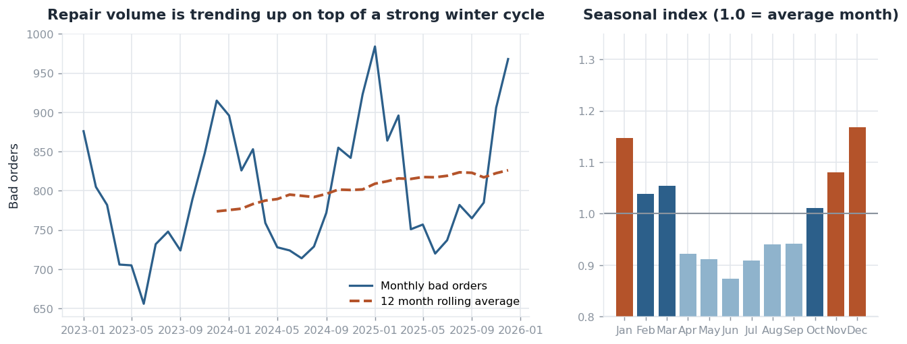
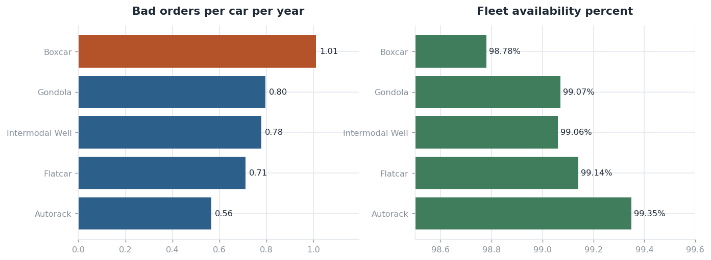
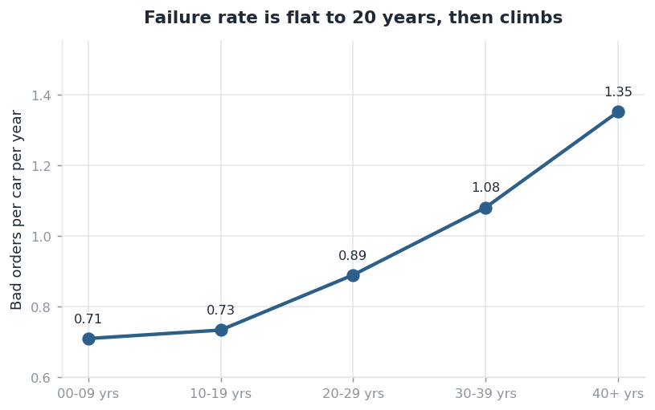
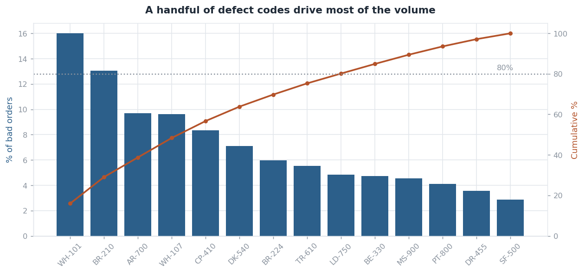
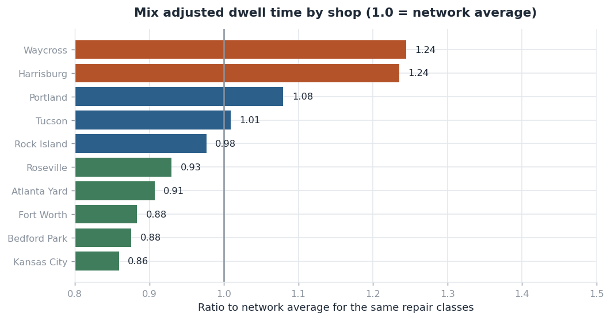
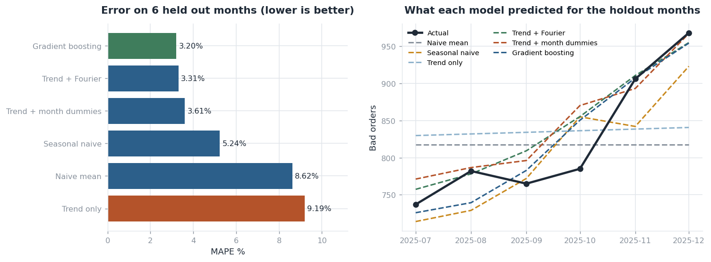
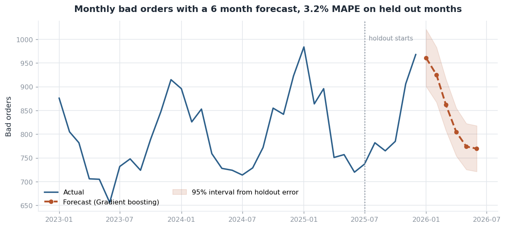
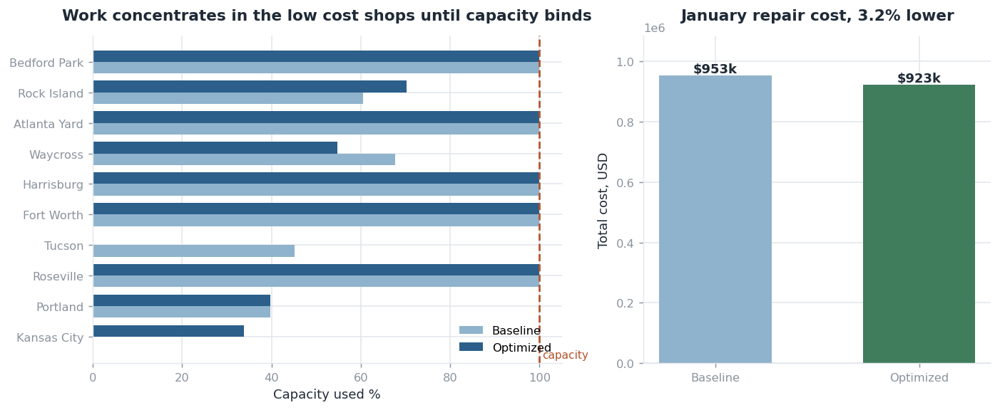

# Railcar Fleet Maintenance Analytics

A fleet of 12,000 railcars breaks down about 800 times a month. Somebody has to sit down every quarter and answer three questions:

1. What's actually breaking, and is it getting worse?
2. How many repairs are coming next month?
3. Which shop should each of those cars go to?

This project answers all three. It starts with messy repair records and ends with a dashboard, and you can run the whole thing with one command.

```bash
pip install -r requirements.txt
python run_all.py
```

That takes about 30 seconds. Then open `outputs/dashboard.html` in a browser. No database server to set up, no cloud account, no API keys.

---

## Why I built it this way

I've noticed that a lot of data projects stop at "here's a model and here's its accuracy score." But when I think about what analytics work actually looks like day to day, the model is a fairly small slice of it. Most of the time goes into figuring out whether the data can be trusted, agreeing on what a metric means so two reports don't contradict each other, deciding what to actually do once you have a forecast, and then explaining all of it to someone who doesn't want to hear about Fourier terms.

So I built this in the order that work happens:

**messy data → cleaned and checked → shared definitions in SQL → analysis → forecast → decision → dashboard**

Each step is its own script, numbered, and you can read them in order. I've written the reasoning directly into the code comments where the decisions happen, rather than keeping it separate.

A quick note on honesty: the data is synthetic. Railcar maintenance records aren't public, so I wrote a generator that produces realistic patterns. That means the findings below aren't discoveries, since I chose the patterns that the analysis then finds. What the project shows is method, not insight. I'd rather say that upfront than have you wonder.

---

## What's in here

| Step | Script | What it does |
|---|---|---|
| 1 | `01_generate_data.py` | Builds a 12,000 car fleet and 3 years of repair history, then makes about 7% of it messy on purpose |
| 2 | `02_data_quality.py` | Runs 9 checks, fixes what's fixable, sets aside what isn't |
| 3 | `03_build_database.py` | Loads it into SQLite, builds 6 reporting views, times the indexes |
| 4 | `04_fleet_health_report.py` | The actual analysis: trends, car types, age, defects, shops |
| 5 | `05_repair_demand_forecast.py` | Tests 6 forecasting approaches, picks one, projects 6 months out |
| 6 | `06_shop_assignment_optimizer.py` | Decides where to send the forecasted repairs |
| 7 | `07_build_dashboard.py` | Bundles everything into one HTML file |

---

## Some vocabulary first

Rail has its own terms and they're worth knowing before the charts make sense.

A **bad order** is a railcar pulled out of service because something's wrong with it. It's the basic unit of everything here. One bad order is one car, one date, one defect, one shop.

**Dwell** is how long the car sat before it was released back into service. It includes waiting for parts, not just the time somebody was working on it, because a car waiting in a yard is just as unavailable as a car up on a jack.

**Bad order rate** is bad orders per car per year. Not percent of the fleet. A car can break several times a year, so a percentage doesn't work here.

Repairs come in three flavors. **Running repairs** are quick and common, like a worn brake shoe. **Program repairs** are planned work. **Heavy repairs** are the expensive ones, like a cracked frame.

---

## Step 1: Making the data

Since I couldn't get real data, I wrote a generator with patterns worth finding: older cars break more, boxcars break more than autoracks, winter is worse than summer, and volume creeps up as the fleet ages.

Then I broke about 7% of it on purpose. Duplicate billing records, release dates that come before the bad order date, missing labor hours, car IDs that don't exist in the fleet, defect codes with inconsistent spacing and capitalization, and a few labor hour entries that are off by a factor of sixty.

That last part matters. If I'd generated clean data, step 2 would just be decoration.

---

## Step 2: Checking whether the data can be trusted

Nine checks run before anything gets modeled. The rule I set for myself was that no row disappears quietly. Every record either passes, gets fixed under a rule I wrote down, or goes into a quarantine file with a reason attached so somebody could go ask the shop what happened.

| Check | Severity | Rows | What I did |
|---|---|---|---|
| Duplicate event IDs | High | 618 | Kept the first, dropped the rest |
| Defect code formatting | Medium | 756 | Fixed the capitalization and spacing |
| Defect code not in master | High | 0 | Would quarantine |
| Car IDs not in the fleet | High | 228 | Quarantined |
| Shop IDs not in the shop list | High | 0 | Would quarantine |
| Release date before bad order date | High | 404 | Quarantined |
| Dwell over 180 days | Low | 0 | Would flag but keep |
| Labor hours way too high | Medium | 30 | Capped at 240 hours |
| Labor hours missing | Medium | 873 | Filled in with the median for that defect |

That's **2,909 problems found across 30,072 rows**, and 95.8% of rows made it through to the analysis.

Two decisions in there I'd defend if somebody questioned them.

**The outliers got capped instead of deleted.** A repair logged at 480 hours is almost certainly somebody entering minutes instead of hours. But the repair still happened. If I delete the row, I'm undercounting repair volume, and repair volume is what the entire forecast is built on. Capping keeps the event and limits the damage to the cost number.

**The missing labor hours got filled in per defect code, not with one overall median.** A missing brake shoe job and a missing frame repair aren't the same size. Using one number for both would inflate the small jobs and flatten the big ones, and the big ones are where the money is.

There's one more thing worth pointing out. The 228 orphan car IDs are only 0.8% of the data, which sounds ignorable. It isn't. Those rows can't be joined to car type or build year, so they'd silently vanish from every breakdown by car type while still being counted in the totals. That's exactly the kind of thing that makes two reports disagree and nobody can figure out why.

---

## Step 3: Setting up the database

I used SQLite so this runs anywhere without installing anything, but the SQL is standard enough to move to Azure SQL or Fabric without much rewriting.

One fact table at the level of one bad order event, plus three lookup tables for cars, shops, and defect codes.

Then six views in `sql/02_views.sql` that hold every shared definition. This is the part I'd argue is more useful than it looks. Bad order rate gets defined once. The dashboard, the forecast, and anybody writing an ad hoc query all read the same definition. They can't drift apart, because there's only one version of it.

I also wanted to check whether the indexes I picked were actually doing anything, so the script drops them, times a realistic shop report query 60 times, puts them back, and times it again:

```
without indexes:   5.53 ms   (full table scan)
with indexes:      3.96 ms   (index lookup)
                   about 28% faster
```

To be straight about it, saving 1.5 milliseconds on a 29,000 row table doesn't matter. I'm including it because the method is the point. The same query plan change is what separates a two second dashboard from a two minute one when the table has 30 million rows, and the way you find out which columns to index is by measuring rather than guessing.

---

## Step 4: What the data actually says

All the aggregation happens in SQL against those views. Python only formats things and draws charts.

### Volume is growing, and winter is rough



Repair volume went up **6.8% over three years**, from 9,286 bad orders to 9,915. On top of that there's a strong seasonal cycle. December runs **17% above** an average month and June runs **13% below**, so there's a 34% swing between the busy month and the quiet one.

The practical version of that: if you staff a shop off an annual average, you're wrong half the year. You're short in January and sitting idle in June.

The seasonality isn't uniform across defects either, which I found more interesting than the seasonality itself. Wheel and brake failures run 23 to 27% above average in winter. Paint work and lading damage barely move. So January isn't just "more of everything," it's a different mix of work, which changes what parts you stock, not just how many people you schedule.

### Some car types are harder on you than others



Boxcars are the problem fleet at **1.01 bad orders per car per year**, which is 79% higher than autoracks. Availability sits between 99.0% and 99.4% across types, which sounds like a rounding error until you multiply it by 12,000 cars and 365 days.

### Age matters, but not in a straight line



This one surprised me a little. The failure rate is basically flat until about 20 years, then it bends upward. Cars past 40 years fail **90% more often** than cars under 10.

The shape is the useful part. If failure rate rose steadily with age, you'd retire cars on a simple schedule. Since it's flat and then bends, there's an age where the economics change, and that's a much more specific conversation to have.

### A few defects cause most of the trouble



**Nine of the 14 defect codes cause 80% of all bad orders**, led by thin wheel flanges.

But ranking by volume hides something. Cracked sills and frames are only **2.9% of bad orders and 13.4% of repair spend**, which is a 4.6x ratio. If you built a report sorted by how often things happen, that defect would sit near the bottom of the page while quietly eating an eighth of the budget.

### Shops aren't turning cars around at the same speed



This is the analysis I'm happiest with, and I nearly got it wrong.

My first version ranked shops by average dwell time. That's unfair, and it took me a minute to see why. Heavy repair shops look terrible on raw dwell because frame work takes longer at every shop. So the ranking was mostly measuring which shops get sent the hard jobs.

The fix is to compare each shop against the network average **within the same repair class**, then average those comparisons. What's left is the part of dwell that the shop actually controls.

The ranking shifts when you do that, and the finding holds up. Waycross holds cars **24% longer** than the network and Kansas City **14% shorter**, after accounting for what each one is working on. That's a scheduling difference, not a job mix difference.

### A small number of cars cause a lot of the cost

**515 cars, about 4.3% of the fleet**, had six or more bad orders in three years. They account for **11.7% of total repair spend**. That's a reasonable candidate list for pulling in for a full inspection instead of patching them one more time.

---

## Step 5: Forecasting how much repair work is coming

Here's the constraint I was working with: 36 monthly observations. That's a small sample, and a small sample can only really support a trend and a seasonal shape. Maybe five parameters. Anything with more knobs will fit the noise, look great in training, and fall apart on new months.

So instead of picking a model based on what sounds impressive, I tested six of them on six months that none of them had seen.

```
Training:  Jan 2023 to Jun 2025  (30 months)
Held out:  Jul 2025 to Dec 2025  ( 6 months)
```



| Model | Error (MAPE) | Average miss |
|---|---|---|
| Gradient boosting | 3.20% | 25 cars |
| Trend plus seasonal terms | 3.31% | 26 cars |
| Trend plus month dummies | 3.61% | 28 cars |
| Same month last year | 5.24% | 44 cars |
| Last 12 month average | 8.62% | 73 cars |
| Trend only | 9.19% | 76 cars |

### Why I didn't use the model that scored best

Gradient boosting came first by a tenth of a percentage point, on six data points. I used the second one instead, and this is the decision I'd most want to talk through.

Part of it is that a tenth of a point on six observations is noise. There's no real difference between those two numbers at that sample size.

The bigger reason is structural. A tree based model predicts by averaging training examples that land in the same leaf, so it can't produce a number outside the range it was trained on. It can't extrapolate.

I didn't want to just claim that, so I checked. I asked both models about the next 12 months:

| | Next 12 months | Implied growth |
|---|---|---|
| Last 12 months, actual | 9,915 | |
| Gradient boosting | 9,874 | -0.4% |
| Trend plus seasonal terms | 10,250 | +3.4% |

The fleet has grown about 3.3% a year for three years running, and it's aging, which is the mechanism behind the growth. Gradient boosting projects that stopping dead. Not because it has a view about the fleet, but because it's hit its ceiling.

The thing I took away from this: the held out months sat close to the training range, so this problem was completely invisible in the error table. A validation setup can be correctly designed and still fail to test the thing that matters. If a forecast's whole job is to reach forward, then how it extrapolates is a requirement, and no error column is going to tell you about it.

I also left "trend plus month dummies" in the comparison on purpose. It has exactly the same information as the seasonal version but uses 12 parameters instead of 5, and it scored worse. That's what overfitting looks like when you can actually watch it happen.

### The forecast



| Month | Bad orders | Likely range | Labor hours | Cars per day |
|---|---|---|---|---|
| Jan 2026 | 961 | 901 to 1,021 | 8,476 | 31.6 |
| Feb 2026 | 925 | 867 to 983 | 8,162 | 30.4 |
| Mar 2026 | 862 | 808 to 916 | 7,606 | 28.4 |
| Apr 2026 | 805 | 754 to 855 | 7,098 | 26.5 |
| May 2026 | 774 | 725 to 823 | 6,828 | 25.5 |
| Jun 2026 | 770 | 721 to 818 | 6,789 | 25.3 |

January is **16% above** the trailing twelve month average, so that's the month to staff for.

The ranges come from how wrong the model actually was on the held out months, not from a formula. If it missed by 3.3% on months it had never seen, then 3.3% is what I'm quoting. A textbook standard error assumes the model is correctly specified, and I'd rather not assume that.

I also ran the same approach per car type. Error ranges from **4.6% to 9.8%**, and it gets worse as the segments get smaller. Autoracks are the worst at 9.8% on a 720 car fleet. I'm reporting that rather than burying it, because anyone planning off the autorack number should know it's softer than the network number.

---

## Step 6: Deciding where to send the cars

The forecast says 961 cars in January. This step figures out which shop each one goes to.

It's an integer program. For every combination of region and repair class, it decides how many cars go to each of the 10 shops. Cost per car is:

```
labor  =  repair hours  x  shop's hourly rate  x  specialty penalty
move   =  miles from the car's region to the shop  x  $2.10 per mile
```

Rules it has to respect: every car gets assigned somewhere, no shop takes more than its capacity, and no car travels more than 1,500 miles for a repair.

The specialty penalty is my favorite part. A shop that specializes in running repairs can absolutely do a heavy frame job, it just takes longer. So hours get multiplied by 1.00 for a good match and up to 1.30 for a bad one. Nobody had to write a rule saying "send frame work to heavy shops." The cost function produces that behavior on its own, and it also lets the model override it when the geography says otherwise.

**Why bother with an optimizer instead of a rule?** Because the tradeoff genuinely doesn't have an obvious answer. Roseville has the highest labor rate but sits right next to western demand. Waycross is cheap but small. Sending a car 900 miles to save $20 an hour is clearly right for a 40 hour frame repair and clearly wrong for a 2 hour air hose swap. A rule has to commit to one answer. The optimizer prices all 150 combinations at once.

**What I compared it against.** Not a strawman. The baseline is "nearest shop in the home region, spill to the next nearest when it's full, place the biggest jobs first," which is roughly what a dispatcher does and roughly what the history shows: 14.2% of repairs went outside their home region. Both plans are priced with the identical cost function, so the difference is the decision and not the accounting.



| | Baseline | Optimized |
|---|---|---|
| Total cost | $953,024 | $922,553 |
| Cost per car | $992 | $960 |
| Sent out of region | 0% | 5.6% |
| Average move | | 89 miles |

That's a **3.2% reduction, roughly $366K a year** at this volume.

I want to be plain that this is a modest number. The network already has about 24% slack in the peak month, and when capacity is loose, sending cars to the nearest shop is already close to right. The savings would grow as utilization tightens, which is what the volume trend from step 4 says is coming.

Three things came out of this that I think matter more than the dollar figure.

**The plan concentrates work rather than spreading it.** Five of ten shops finish at exactly capacity. That tells you capacity is the binding constraint, not labor rate. Which means buying a slot at a cheap shop is worth more than negotiating a better rate anywhere, and that's a useful thing to know before a budget conversation.

**Specialty matching went down and the plan still costs less.** It dropped from 38% to 33%. The optimizer traded specialty match for better rates and shorter moves. That's the tradeoff working, not a bug: a mismatched shop 100 miles closer can beat a matched shop 600 miles away. I'm flagging it because it's the number somebody would look at and assume the model is broken.

**One shop drops to zero cars, and I don't think the model gets the final word on that.** Tucson sits 711 miles from the nearest demand centroid, so a closer shop beats it on both distance and rate for every single job. That's a real signal worth a conversation about whether that capacity is in the right place. But it's also partly an artifact of a choice I made: I collapsed demand into five regional centroids, which is unfair to a shop serving a spread out area. I'd want finer geography before anybody acted on it. The limitation is part of the finding.

**And then the "what if."** The question right after "what's the plan" is always "what happens if something goes wrong." I halved the busiest shop's capacity, which is roughly what a two week shutdown looks like across a month. Still workable, but it adds **7.9% to monthly cost** and pushes out of region moves from 54 cars to 116. Answering that took one re-solve, which is honestly the most practical argument for building the optimizer at all.

---

## Step 7: The dashboard

Everything lands in one HTML file with the images embedded, so it opens in any browser and survives being emailed around. It's standing in for the Power BI or Fabric report a real team would publish.

The part that matters is that every number on the page is read from the CSV files the earlier steps wrote. Nothing is typed in by hand. So the dashboard can't drift away from the analysis, and re-running the pipeline updates it.

Open `outputs/dashboard.html` after your first run.

---

## Things I'd do differently

Being straight about the gaps, since somebody's going to ask.

- **The data is synthetic**, and I chose the patterns the analysis then finds. That's circular. What this shows is method, not discovery.
- **36 months isn't enough** to tell a trend apart from the upswing of a longer cycle. With five years I'd test that properly.
- **No weather data.** The seasonal term treats winter as an average effect. An actual cold snap forecast would probably beat that.
- **The optimizer plans one month at a time.** Real repairs cross month boundaries and shop queues carry over, so a rolling multi period version would be more honest about capacity.
- **My region centroids are coarse.** Five points for the continental US is fine for a rough ranking and not fine for drawing conclusions about a remote shop, which the Tucson result shows.
- **The specialty penalty numbers are my assumption**, not a measurement, and they drive the routing. I'd want to validate them against real shop throughput before trusting the assignment plan.
- **No survival model.** Predicting which specific car fails next is a different and more valuable problem than predicting how many will. The repeat offender list is a crude first pass at it.

---

## How it's organized

```
railcar-fleet-maintenance-analytics/
├── README.md
├── requirements.txt
├── run_all.py                          runs everything
├── sql/
│   ├── 01_schema.sql                   tables and indexes
│   ├── 02_views.sql                    6 views holding every shared definition
│   └── 03_reporting_queries.sql        7 ad hoc queries for common questions
├── src/
│   ├── 01_generate_data.py
│   ├── 02_data_quality.py
│   ├── 03_build_database.py
│   ├── 04_fleet_health_report.py
│   ├── 05_repair_demand_forecast.py
│   ├── 06_shop_assignment_optimizer.py
│   ├── 07_build_dashboard.py
│   └── viz_style.py                    shared chart styling
├── docs/
│   ├── DATA_DICTIONARY.md              every table, column, and metric defined
│   ├── METHOD_NOTES.md                 the judgment calls, written out
│ 
├── data/
│   ├── raw/                            generated CSVs
│   ├── clean/                          cleaned table plus quarantined rows
│   └── railpulse.db                    SQLite database
└── outputs/
    ├── dashboard.html                  start here
    ├── charts/                         the 8 charts above
    └── *.csv                           every table behind the dashboard
```

If you want to poke at the data yourself, `data/railpulse.db` is a normal SQLite file and `sql/03_reporting_queries.sql` has seven queries for the questions that come up most often.

---

## Running it

```bash
pip install -r requirements.txt
python run_all.py
```

Python 3.12, with pandas, numpy, scikit-learn, PuLP, and matplotlib. SQLite comes with Python so there's nothing to install for the database.

Everything is seeded, so you'll get the same numbers I did. The one exception is the index timing in step 3, since that measures actual wall clock time and moves a couple of points depending on the machine.
